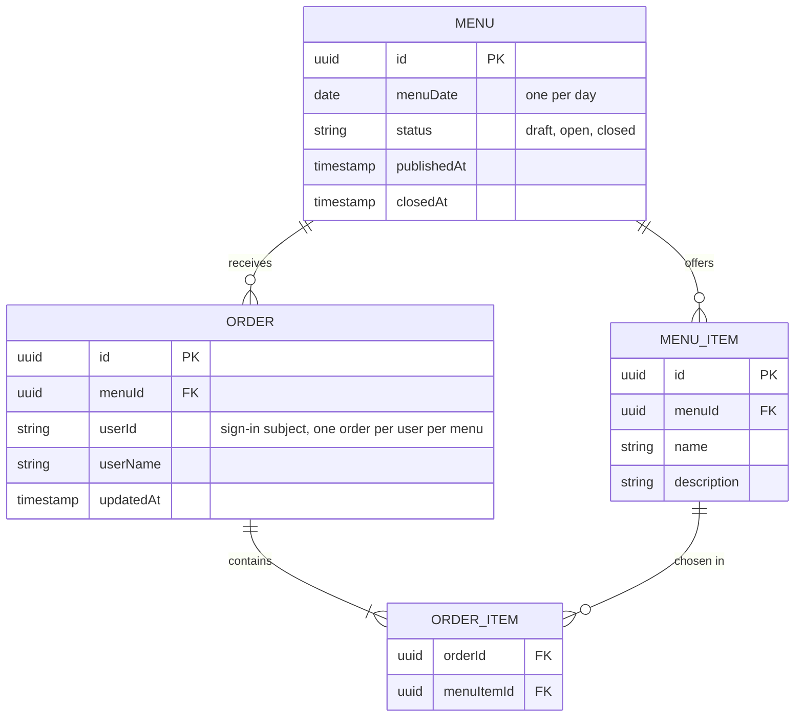

# Domain model

Each day has one menu of typed-in items. Staff place at most one order per day from it; the office manager closes ordering for good. People come from the sign-in provider, so orders keep the person's id and display name.

A menu's status moves only draft, then open, then closed. An order always holds at least one item.